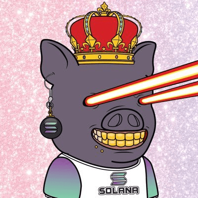
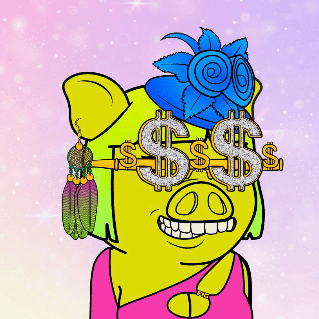
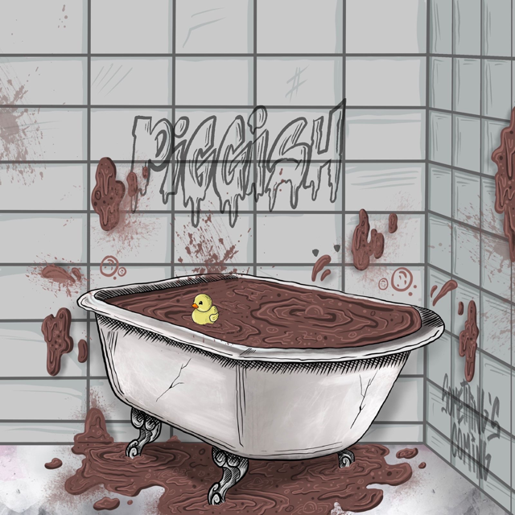

<h1>🐷 Piggy Gang</h1>

<b>Apps and art for the whole gang — start anywhere.</b>

  
  
  

  
  
  
  

Four NFT collections on Solana, a Rust indexer that knows everything about them,
an on-chain raffle program and six web apps on top — all built in the open.

<h2 align="center">The gang</h2>

| Collection | Supply | Standard | Where |
|---|---:|---|---|
| **Piggy SOL Gang** — ten thousand piggies, straight off the chain | 8,127 | Token Metadata | [Magic Eden](https://magiceden.io/marketplace/piggy_sol_gang) |
| **Piggy Girl Gang** — pretty, fierce and dressed for it | 4,801 | Token Metadata | [Magic Eden](https://magiceden.io/marketplace/piggy_girl_gang) |
| **Piggy Gang** — meaner art, one migration at a time | 745 | Metaplex Core | [Magic Eden](https://magiceden.io/marketplace/pig_gang) |
| **Pig Mud** — straight out of the mud | 2,039 | Token Metadata | No listing yet |
|  **$PIGGY** — the gang's coin | — | SPL, 9 decimals | [Solscan](https://solscan.io/token/FUtxQAXuC4TgQvF7C5RTRsgqHvPqn4iHhMicRZKV775E) |

Supply leaves out burned NFTs, as read from the indexer on 8 November 2026. [piggygang.net](https://piggygang.net) always shows today's.

Piggy Gang is Piggy SOL Gang in new clothes. Migrating takes two Piggy SOL Gang: both burn,
and the one you picked comes back as a Metaplex Core asset with the same number and redrawn art.
It is one transaction, so if the mint fails, neither piggy burns.

<h2 align="center">How it's built</h2>

- **One spec runs the whole stack.** The indexer's OpenAPI file is frozen and hand-written; the explorer vendors a byte-identical copy, generates its typed client from it, and CI fails if the two drift apart. Changing the contract is always two commits — indexer first.
- **The frontend shipped before the backend.** With nothing configured, the explorer serves committed fixtures through the very same generated client the real API will use. One server-side variable switches it over.
- **The database makes two owners unrepresentable.** Ownership is stored as intervals with a GiST `EXCLUDE` constraint, so no NFT can have two open owners at once — not by convention, by the schema.
- **Search is quick.** Filtering 10,000 NFTs by traits benches at a p50 of 40 ms on Postgres 17 — 5 ms for text search — against an acceptance bar of 100 ms.
- **In the browser, one package talks to Solana.** `@wallet-standard/app`, and nothing else: no web3.js, no wallet-adapter, no Buffer polyfill. The wallet signs and broadcasts, the app just watches the signature, and no holder's key ever reaches a server.
- **Adding a collection is config, not code.** One entry in `collections.toml` plus a mint list. Not a single on-chain address appears in Rust, SQL or tests.
- **Free is load-bearing.** A paid ticket would make a raffle a lottery, so nobody ever pays to enter. Each Piggy you enter earns an entry, up to ten, and a Full Gang — one each from Piggy SOL Gang, Piggy Girl Gang and Piggy Gang — adds three more. Entrants pay only network gas, and the rent their entries front comes back when the raffle settles.
- **The program will hold the prize.** Once it ships, prizes will sit in on-chain escrow from the moment a raffle opens, and not even the admin multisig will be able to redirect one. A VRF draw will pick the winner, and anyone will be able to recompute it from the published randomness.
- **Tests run real mainnet programs.** The raffle program's suite runs in-process on LiteSVM against Token Metadata and mpl-core bytecode dumped from mainnet — no validator, about a tenth of a second. Every deploy ships a reproducible build whose hash anyone can check on chain.
- **Hosts die; the art doesn't.** The collections' image hosts have gone dark twice. Every file still on a third-party host is backed up — about 21 GB, with a sha256 for each — and every on-chain URI is moving to our own domain, assets.piggygang.net, so the next storage move is a rewrite, not another on-chain update.

<h2 align="center">Repos</h2>

| Repo | Lang | What it does | Status |
|---|---|---|---|
| [`indexer`](https://github.com/piggygang/indexer) | Rust | Indexes every Piggy NFT — traits, owners and full history — and serves them over a REST API | ✅ **Live** · [api.indexer.piggygang.net](https://api.indexer.piggygang.net/v1/collections) |
| [`raffles-program`](https://github.com/piggygang/raffles-program) | Rust | The Anchor program behind Raffles — prize escrow, free entries, the draw and rent refunds | 🔨 Building |
| [`explorer`](https://github.com/piggygang/explorer) | TypeScript | Search the collections by trait, look up a wallet, read an NFT's history | ✅ **Live** · [explorer.piggygang.net](https://explorer.piggygang.net) |
| [`dressme`](https://github.com/piggygang/dressme) | TypeScript | Dress your piggy up in any traits you like and download the picture | ✅ **Live** · [dressme.piggygang.net](https://dressme.piggygang.net) |
| [`raffles`](https://github.com/piggygang/raffles) | TypeScript | Free raffles for holders — nobody ever pays to enter | 🧪 Preview · [raffles.piggygang.net](https://raffles.piggygang.net) |
| [`migrate`](https://github.com/piggygang/migrate) | TypeScript | Swap your piggy to the new art — two Piggy SOL Gang in, one Piggy Gang out | 🔨 Building |
| [`alpha-art`](https://github.com/piggygang/alpha-art) | TypeScript | alpha.art coming back as an open Solana marketplace | 🧪 Preview · [alpha.art](https://alpha.art) |
| [`website`](https://github.com/piggygang/website) | TypeScript | The hub — every app and collection in one place | ✅ **Live** · [piggygang.net](https://piggygang.net) |

**Next up**

- **Raffles v1** — the program, a draw crank and the app, through devnet acceptance to mainnet.
- **Collection upgrades** — every collection's metadata on assets.piggygang.net, Pig Mud's image back, certified Piggy SOL Gang and Piggy Girl Gang collections, and full Piggy Gang history in Explorer.
- **Migration** — migrate.piggygang.net opens to every holder.

<h2 align="center">The stack</h2>

The backend is Rust 1.90 — actix-web, sqlx and Postgres 17.6, deployed on Railway.
On chain, Raffles is an Anchor 1.2 program on Rust 1.95, tested in-process on LiteSVM.
Every frontend is the same shape on purpose: Next.js 16 App Router, React 19,
Tailwind v4, Node 24 and pnpm 11, on Vercel. Clone one and you already know the next.

**[piggygang.net](https://piggygang.net)** · **[Discord](https://discord.gg/8SjGR8Srvz)** · **[X](https://x.com/PiggySolGang)** · **[GitHub](https://github.com/piggygang)**

Piggy SOL Gang · Piggy Girl Gang · Piggy Gang · Pig Mud · $PIGGY

